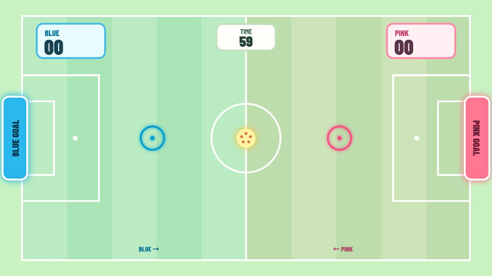

# FLOOR SOCCER — 床サッカー

カメラで2人の足元を認識し、プロジェクターで床に映したボールを蹴る、60秒の対戦ゲームです。青は左、ピンクは右からスタート。相手側のゴールへボールを入れた回数で勝敗が決まります。姿勢推定で左右のかかと・つま先を検出し、カメラ映像と投影面の対応を四隅で設定します。

公開ページ: <https://ma4130.github.io/kaken-floor-soccer/>



## 起動

Node.js 20.19 以降で実行します。

```bash
npm install
npm run dev
```

表示された `http://localhost:5173/` を Chrome で開きます。カメラ API のため、他の端末からアクセスするときは HTTPS が必要です。初回の姿勢認識モデル取得にはインターネット接続が必要です。

## 設置と遊び方

1. 操作画面の「投影画面を開く」を押し、そのウィンドウをプロジェクターのディスプレイに移動して「全画面表示」を押します。
2. カメラを、2人の全身と両足および投影面の四隅が映る位置に固定します。斜め上から床を向けた配置が使いやすいです。ブラウザでカメラを許可します。
3. 「四隅の設定を始める」を押します。投影画面に表示された番号 **1 左上 → 2 右上 → 3 右下 → 4 左下** の位置を、操作画面のカメラ映像で順にクリックします。設定はブラウザに保存されます。カメラやプロジェクターを動かした場合は再設定してください。
4. 「対戦スタート」を押します。青は右のピンクのゴール、ピンクは左の青のゴールへ、足でボールを蹴ります。60秒後、得点が多い側の勝ちです。同点なら引き分けです。

カメラなしで動作を試す場合は「キーボードで対戦」を選びます。青は **W/A/S/D**、ピンクは **矢印キー**で動かします。プレイヤーの円をボールに当てるとキックできます。投影画面にも同じプレイが表示されます。

## 注意点

- 足の位置は MediaPipe Pose Landmarker の左右のかかと・つま先から推定します。足だけしか写らない真上のカメラでは全身姿勢を捉えにくいため、2人の全身が入る画角にしてください。カメラ上で認識が途切れた場合は、左右の立ち位置に戻るとチームを再判定しやすくなります。
- 投影光が強すぎるとカメラが白飛びします。露出を下げるか、カメラとプロジェクターの角度を変えてください。
- 映像はブラウザ内で処理し、サーバーへ送信しません。モデルと WASM は Google / jsDelivr から取得します。
- 投影画面と操作画面は同じオリジンで開きます。別ウィンドウ間の通信には BroadcastChannel を使用します。

## 開発

```bash
npm test
npm run build
```

主要なロジックは `src/core.js`、画面とカメラ処理は `src/main.js` にあります。
